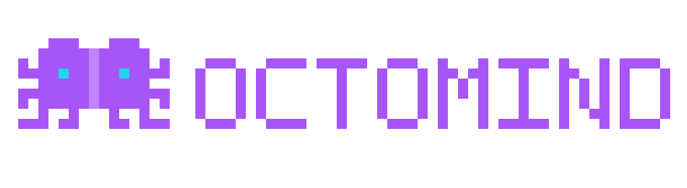

<div align="center">
  <a href="https://octomind.run">
    
  </a>

  <h3>The CLI-first AI coding agent runtime.</h3>
  <p>Pipe it, schedule it, embed it. One binary, any model, MCP-native —<br />built for autonomous work, not just chat.</p>

  [](https://github.com/Muvon/octomind/actions/workflows/ci.yml)
  [](https://crates.io/crates/octomind)
  [](https://github.com/muvon/octomind/actions/workflows/ci.yml)
  [](LICENSE)
  [](https://github.com/muvon/octomind/stargazers)

  [Website](https://octomind.run) · [Docs](https://octomind.run/docs/) · [Tap Registry](https://github.com/muvon/octomind-tap) · [Benchmarks](#benchmarks) · [Issues](https://github.com/muvon/octomind/issues)
</div>

<p align="center">
  
</p>

---

Octomind is a CLI-first AI coding agent runtime. It gives an LLM real access to your repo — reading and writing files, running shells, searching code, delegating to sub-agents — through [MCP](https://modelcontextprotocol.io) tools. The same session engine works **interactively**, **piped through stdin**, as a **background daemon**, over **WebSocket**, or as an **ACP sub-agent** inside another agent's stack.

```bash
# Interactive
octomind run developer:general

# Piped — CI, scripts, automation
echo "Explain the auth module" | octomind run developer:general --format plain

# Daemon — keep it alive, talk to it from another terminal
echo "watch the build" | octomind run --name watcher --daemon --format jsonl
octomind send --name watcher "run the test suite"
```

## Why Octomind?

Most coding agents assume a human is watching the screen. Octomind is built for the work that keeps going after you leave.

- **Policy as code, not approval popups.** Deterministic [guardrails](doc/usage/18-guardrails.md) — pre-call guards, post-result hooks, post-turn validators — live in TOML and scripts, so they work in CI, daemons, and scheduled runs.
- **Proven on real PRs.** It solved 24 of 25 held-out tasks at lower cost than the closest competitor. See the [benchmarks](#benchmarks).
- **Ready-made specialists.** `octomind run developer:general` pulls a packaged agent (prompt, model, MCP servers, tool permissions) from a [tap](doc/integration/04-tap-system.md). Publish your own with one repo.
- **Sessions that stay sharp.** Adaptive [compression](doc/usage/08-compression.md) keeps long tasks moving while retaining task knowledge and the live exchange.
- **Any model, any budget.** Use Octomind Cloud or your own key (OpenRouter, Anthropic, OpenAI, DeepSeek, Ollama, and more), pick a model per role, and set spend thresholds per request and per session. A request over its threshold stops; at the session threshold a terminal session asks y/N before continuing, while a non-interactive `octomind run` stops with exit code 75.
- **One config.** Models, tools, roles, guardrails, budgets: all TOML, no framework code.

## Quick Start

**1. Install** (macOS, Linux):

```bash
curl -fsSL https://raw.githubusercontent.com/muvon/octomind/master/install.sh | bash
```

On Windows, in PowerShell:

```powershell
irm https://raw.githubusercontent.com/muvon/octomind/master/install.ps1 | iex
```

On macOS, you can also install with Homebrew:

```bash
brew install muvon/tap/octomind
```

**2. Get model access.** The fastest path is Octomind Cloud, which includes models and needs no configuration:

```bash
octomind login
```

Prefer your own provider key? Skip login and export one (also `OPENAI_API_KEY`, `ANTHROPIC_API_KEY`, `DEEPSEEK_API_KEY`), then follow [Model access](#model-access) to point the config at it:

```bash
export OPENROUTER_API_KEY="your_key"
```

**3. Run a specialist** in your project:

```bash
cd ~/your/project
octomind run developer:general
```

You're now in a session with an agent that can read your code, run commands, and edit files. The interface is a plain line prompt with markdown rendering — no TUI to learn, so it works over SSH, in `tmux`, and in CI logs. The first time you run a specialist, it may install its tools and ask for credentials.

> `developer:general` comes from the default tap [`muvon/tap`](https://github.com/muvon/octomind-tap), not your local config. Plain `octomind run` starts the config's default role, `assistant:concierge`.

Try the [recorded bug-fix demo](examples/fix-a-bug): two failing tests, an agent fix, and an independent test rerun.

## Benchmarks

Measured on [octobench](https://github.com/Muvon/octobench) against **25 tasks harvested from merged pull requests** across Python, PHP, Rust, C++, and JavaScript. Each agent works in the pre-fix repo; held-out tests from the merged fix decide pass or fail. These are the published July 30, 2026 results, not a measurement of this checkout.

| | solved | judge Σ / 2500 | cost | wall time |
|---|---|---|---|---|
| **octomind + glm-5.2** | **24/25** | **2264** | $63.43 | 3.6h |
| claude code + claude-opus-5 | 23/25 | 2262 | $81.79 | 6.7h |
| codex + gpt-5.6-sol | 21/25 | 2127 | $14.86 | 1.0h |
| opencode + glm-5.2 | 19/25 | 2093 | $129.54 | 3.3h |

- **The harness matters.** opencode used the same model and endpoint; octomind solved 24 vs 19 at roughly half the cost. All four agents ran stock invocations with no tuning, so this measures the whole harness, not individual features.
- **Worst-case pricing, still ahead.** glm-5.2 ran without prompt caching while Opus billed ~97% of context re-reads at cache rates — and octomind still led on solves, cost, and wall time.
- **Reproducible.** Per-case table, artifacts, and reproduction guide: [BENCHMARK.md](https://github.com/Muvon/octobench/blob/8aa39684ff6103782aacb1bd79ea98e96e50d6cf/BENCHMARK.md). Background: [blog post](https://octomind.run/blog/coding-agent-benchmark-real-prs).

## Guardrails: Policy as Code

Drop a `.agents/guardrails.toml` in your repo. The runtime enforces it deterministically, with no code to compile and no plugin to install.

```toml
# Pre-call deny — block a class of calls before they execute
[[guard]]
match   = "shell(command=^rm\\s+-rf?)"
message = "rm -rf blocked."

# Conditional rule — only fires after the agent ran git status this session
[[guard]]
match   = "shell(command=git push)"
when    = ["+shell(command=git status)"]
message = "Review changes before pushing."
```

| Layer | When it runs | What it does |
|---|---|---|
| **Guards** | Before a tool call | Deny by capability, argument regex, and session history. A match returns a denial instead of executing the call. |
| **Hooks** | After a tool result | A non-zero exit injects stdout into the agent's inbox — lint and format failures become automatic corrections without restarting the turn. |
| **Validators** | After a turn | Scripts the agent reads on its next turn. This replaces "approve this change?" prompts in autonomous loops. |

Hook and validator script examples: [Guardrails guide](doc/usage/18-guardrails.md).

## Five Ways to Run It

The same session engine, exposed however your workflow needs it.

| Surface | Use it for | Docs |
|---|---|---|
| Interactive CLI | Daily work, any domain | [Sessions](doc/usage/05-sessions.md) |
| Piped (`--format plain` / `jsonl`) | CI/CD, shell scripts, automation | [CLI reference](doc/reference/01-cli-reference.md) |
| Daemon + `send` | Background agents, continuous monitoring | [Daemon & hooks](doc/integration/03-daemon-and-hooks.md) |
| WebSocket (`octomind server`) | IDE plugins, dashboards, integrations | [WebSocket server](doc/integration/01-websocket-server.md) |
| ACP (`octomind acp`) | Sub-agent inside another agent or editor | [ACP protocol](doc/integration/02-acp-protocol.md) |

Need machine-readable results? Pass `--schema schema.json` to constrain the final response to a JSON Schema (requires a model with structured-output support). See [Structured output](doc/usage/11-structured-output.md).

## Features

| Feature | What you get | Learn more |
|---|---|---|
| **Specialists & taps** | Packaged agents with model, prompt, MCP servers, and permissions; installs their tool dependencies on first use | [Tap system](doc/integration/04-tap-system.md) |
| **Roles** | Per-role model, temperature, system prompt, tools | [Roles](doc/usage/06-roles.md) |
| **Workflows** | Multi-step pipelines, each step with its own model and toolset | [Workflows](doc/usage/09-workflows.md) |
| **MCP client** | stdio and Streamable HTTP servers, with OAuth; enable/disable servers mid-session | [MCP tools](doc/usage/07-mcp-tools.md) |
| **Intent-driven context** | Skills and capabilities activate on demand, keeping context small | [Skills](doc/usage/15-skills.md) |
| **Local project tools** | Executable scripts in `.agents/tools/` auto-register as tools | [Local tools](doc/usage/17-local-tools.md) |
| **Supervisor & learning** | External planning and gating; file-backed learning records | [Supervisor](doc/usage/14-supervisor.md), [Learning](doc/usage/13-learning.md) |
| **Sandbox** | `--sandbox` restricts filesystem writes to the working directory | [Config reference](doc/reference/03-config-reference.md) |
| **Token efficiency** | Cache-aware accounting and compaction | [Token efficiency](doc/usage/16-token-efficiency.md) |

### Specialists

```bash
octomind run developer:general    # general dev, language skills auto-activate
octomind run doctor:blood         # blood-test interpretation specialist
octomind run lawyer:sg            # legal specialist
```

Running a specialist fetches its manifest from the tap registry, installs any required binaries, resolves credentials, starts the right MCP servers, and then opens the session.

Build and register your own:

```bash
octomind tap init yourteam/my-tap   # scaffold, validate, git-init, and register locally
octomind tap yourteam/my-tap        # on another machine, after publishing to GitHub
```

The `octomind-` prefix is added automatically: `yourteam/my-tap` maps to the repository
`yourteam/octomind-my-tap`.

## Installation

| Method | Command |
|---|---|
| **Install script** (recommended) | `curl -fsSL https://raw.githubusercontent.com/muvon/octomind/master/install.sh \| bash` |
| **Install script** (Windows PowerShell) | `irm https://raw.githubusercontent.com/muvon/octomind/master/install.ps1 \| iex` |
| **Homebrew** (macOS) | `brew install muvon/tap/octomind` |
| **Scoop** (Windows) | `scoop bucket add muvon https://github.com/Muvon/scoop-bucket` then `scoop install muvon/octomind` |
| **Cargo** (Rust 1.95+) | `cargo install octomind` |
| **Docker** | `docker run --rm ghcr.io/muvon/octomind --help` |
| **From source** | `git clone https://github.com/muvon/octomind.git && cd octomind && cargo build --release` |

The install script detects your OS and architecture (Linux and macOS on x86_64/aarch64) and installs to `~/.local/bin/`. Pass `--install-dir <DIR>` or set `OCTOMIND_INSTALL_DIR` to override. On Windows (x86_64/aarch64), `install.ps1` installs to `%LOCALAPPDATA%\octomind\bin` and adds it to your user `PATH`; it honors `OCTOMIND_INSTALL_DIR` and `OCTOMIND_VERSION` too. `install.sh` still works from Git Bash or MSYS2.

**Command not found?** Add the install directory to your `PATH`:

```bash
export PATH="$HOME/.local/bin:$PATH"
```

Building from source requires `protoc`; see [Building from source](doc/dev/01-building-from-source.md) for per-OS prerequisites.

Verify:

```bash
octomind --version
octomind config      # generate the default config
octomind run         # start your first session
```

Shell completions: `octomind completion <bash|zsh|fish|elvish|powershell>`.

### Model access

**Octomind Cloud** — `octomind login` (device-code sign-in, like `gh auth login`) stores a gateway key locally. The default config already uses `octohub:auto`. [Learn more](https://octomind.run/cloud).

**Bring your own key** — set the provider's environment variable (`OPENROUTER_API_KEY`, `OPENAI_API_KEY`, `ANTHROPIC_API_KEY`, `DEEPSEEK_API_KEY`, …) and point the model tables at it. The supervisor and compression profiles also default to `octohub:auto`, so update all three:

```toml
[model]
name = "openrouter:google/gemini-2.5-flash"

[supervisor.model]
name = "openrouter:google/gemini-2.5-flash"

[compression.model]
name = "openrouter:google/gemini-2.5-flash"
```

Provider details and per-role overrides: [Providers & models](doc/usage/04-providers.md).

## Configuration

Config lives at `~/.local/share/octomind/config/config.toml` on macOS and Linux, and under `%LOCALAPPDATA%/octomind/config/` on Windows. Set `OCTOMIND_DATA_DIR` to override the data root.

```bash
octomind config --show       # view current config
octomind config --validate   # validate config
```

Override any value for a single run with `-c`:

```bash
octomind run -c supervisor.enabled=false
```

Full reference: [Configuration reference](doc/reference/03-config-reference.md) · [Environment variables](doc/reference/04-environment-variables.md).

### Session commands

| Command | Description |
|---|---|
| `/help` | Show all commands |
| `/info` | Token usage and costs |
| `/model anthropic:claude-haiku-4-5` | Switch model mid-session |
| `/role developer:general` | Switch to a configured role or tap tag |
| `/new Review auth` | Start a fresh session (title optional) |
| `/done` | Force context compression and start background learning extraction when enabled |
| `/exit` | Exit the session |

Full list: [Session commands](doc/reference/02-session-commands.md).

### Telemetry

Octomind reports anonymous usage: which commands, tools, and models are used, plus timings, token counts, and error kinds. It never sends your code, prompts, file paths, tool arguments, or environment values. Opt out in any of three ways:

```bash
export DO_NOT_TRACK=1          # the cross-tool standard, honored first
export OCTOMIND_TELEMETRY=0    # for subsequent commands in this shell
# or set `telemetry = false` in config.toml
```

Exact field list: [Telemetry](doc/reference/04-environment-variables.md#telemetry).

## Documentation

| Start here | Go deeper | Integrate | Reference |
|---|---|---|---|
| [Installation](doc/usage/01-installation.md) | [Roles](doc/usage/06-roles.md) | [WebSocket server](doc/integration/01-websocket-server.md) | [CLI](doc/reference/01-cli-reference.md) |
| [Quickstart](doc/usage/02-quickstart.md) | [Workflows](doc/usage/09-workflows.md) | [ACP protocol](doc/integration/02-acp-protocol.md) | [Config](doc/reference/03-config-reference.md) |
| [Configuration](doc/usage/03-configuration.md) | [Compression](doc/usage/08-compression.md) | [Daemon & hooks](doc/integration/03-daemon-and-hooks.md) | [Session commands](doc/reference/02-session-commands.md) |
| [Providers & models](doc/usage/04-providers.md) | [Guardrails](doc/usage/18-guardrails.md) | [Editor integration](doc/usage/12-editor-integration.md) | [Environment variables](doc/reference/04-environment-variables.md) |

Full index: [doc/README.md](doc/README.md) · Hosted: [octomind.run/docs](https://octomind.run/docs/).

## Contributing

The most impactful contribution isn't code — **it's specialist agents.** A cardiologist publishing `doctor:medications`. A tax attorney publishing `lawyer:us`. A security researcher publishing `security:owasp`. One TOML file, and everyone facing that problem gets a specialist-grade AI.

- [How to write a tap agent](https://github.com/muvon/octomind-tap)
- [Open issues](https://github.com/muvon/octomind/issues)

Code contributions are welcome too. Set up the hooks and run the gate before you push:

```bash
pip install pre-commit && pre-commit install
make dev    # fmt + clippy + test
```

Commits follow [Conventional Commits](https://www.conventionalcommits.org). Full guide, architecture overview, and code conventions: [CONTRIBUTING.md](CONTRIBUTING.md) · internals: [Architecture](doc/dev/02-architecture.md).

## License

Apache License 2.0 — see [LICENSE](LICENSE).

---

<div align="center">
  <strong>Octomind</strong> by <a href="https://muvon.io">Muvon</a> · <a href="https://octomind.run">Website</a> · <a href="https://octomind.run/docs/">Documentation</a>
</div>
