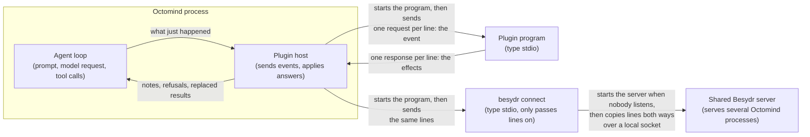
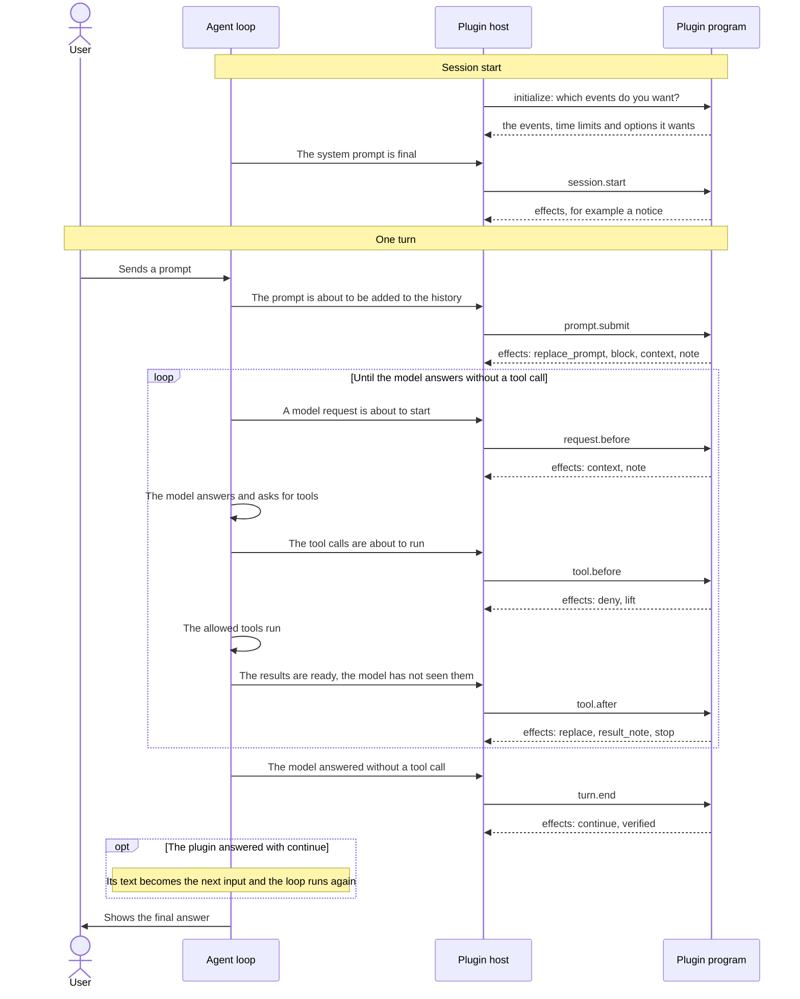

# Plugins: Extend the Agent Loop with a Separate Program

A plugin is a separate program that Octomind sends events to and whose answers Octomind applies. Octomind sends one event
at each fixed point of the agent loop (a session starts, the user sends a prompt, tools are about to run, a turn ends,
and so on). The plugin answers with effects: text to add to the model's context, a note for the model, a tool call to
refuse, a result to replace, a turn to continue, and a few more. A plugin never calls Octomind; it only answers. This
page is for people who write a plugin. Besydr, the supervisor described in [Supervisor](../usage/14-supervisor.md), is a
plugin and is the only one a new configuration lists.

The wire types are in `src/plugins/protocol.rs`. Every field name on this page comes from that file.

## How it works

Octomind runs the agent loop: it takes the user's prompt, asks the model, runs the tools the model calls, and repeats until the model answers without a tool call. A part of Octomind called the plugin host sits beside that loop. At fixed points the loop tells the host what just happened. The host sends that to each plugin as an event, waits for the answer, and hands the effects to the loop. The plugin only answers; it never starts a request of its own.



What the diagram shows:

- Octomind starts a `stdio` plugin as a child process and talks to it over its standard input and output, one JSON object per line. Octomind sends requests, and the plugin sends responses.
- The entry of a new configuration, `besydr connect`, is such a child process. It does not read the protocol. It connects to the shared Besydr server on a local socket, starts that server when nobody listens, and copies lines between Octomind and the server in both directions. The server keeps running after this Octomind process ends and serves other Octomind processes too.
- A `socket` plugin is reached over a local socket and started by Octomind only when nothing answers there. An `http` plugin gets each message as a POST to a URL. Both are left out of the diagram. See [Connection types](#connection-types).
- With several plugins, the host asks them one after the other, in the order of the `plugins` list.

The next diagram follows one turn, from the user's prompt to the final answer. Each arrow to the plugin is an event, and each dotted arrow back is its answer, which holds effects. The text of each answer lists examples; the full list per event is in [Events](#events).



The last pass of the loop has no tool call, so it has no `tool.before` or `tool.after`. After a `continue`, `turn.end` is sent again when the agent stops again. The events that are not in the diagram are `compact.before`, `compact.after`, `subagent.start`, `subagent.end`, `command`, `status`, `judge` and, when the session ends, `session.end`.

## Declaring a plugin

A plugin is one entry in the `plugins` list of `config.toml`. Octomind rejects an entry with a field it does not know.

```toml
[[plugins]]
name = "my-plugin"
type = "stdio"
command = "my-plugin"
args = []
```

| Field | Type | Default | Meaning |
|-------|------|---------|---------|
| `name` | string | required | Unique name, shown in notices and logs. It is also the name of the plugin's install directory. |
| `type` | string | required | `stdio`, `socket` or `http`. |
| `command` | string | none | Program to start. Required for `stdio`. For `socket` it is started only when nothing answers on `path`. |
| `args` | list of strings | `[]` | Arguments of `command`. |
| `path` | string | none | Unix socket path. Required for `socket`. |
| `url` | string | none | Endpoint. Required for `http`; must start with `http://` or `https://`. |
| `headers` | table | `{}` | Extra request headers for `http`. Values may contain `{{ENV:KEY}}`. |
| `enabled` | bool | `true` | `false` keeps the entry in the file and does not start it. |
| `roles` | list of strings | `[]` | Roles the plugin applies to. Empty means all roles. |
| `timeout_seconds` | integer | none | Seconds, 1 to 3600. It is the time `initialize` gets and the most any other event gets. See [Time limits](#time-limits). |
| `install_manifest` | string | none | `https://` URL of a signed release. See [First-use download](#first-use-download). |
| `install_key` | string | none | Base64 of the 32-byte Ed25519 public key the release must be signed with. Required with `install_manifest`, and only valid together with it. |

`{{ENV:KEY}}` in `command`, `args` and header values is replaced by the environment variable. If one is unset or empty,
the plugin does not start and the user sees a notice.

### Connection types

All three carry JSON-RPC 2.0 messages. The method of a request is the event name, `params` is the event, and `result` of
the response is the answer.

| Type | How Octomind connects | Framing |
|------|----------------------|---------|
| `stdio` | Starts `command` with `args` and talks over its standard input and output. Standard error is written to the debug log. | One JSON object per line, in both directions. |
| `socket` | Connects to the unix socket at `path`. When nothing answers and `command` is set, starts the program detached and retries for 5 seconds. Not supported on Windows. | One JSON object per line, in both directions. |
| `http` | Posts each message to `url`. | One JSON object per request body. The response body is one JSON-RPC response. A non-2xx status counts as a failure. |

Details that matter when writing the program:

- Over `stdio` and `socket`, a request carries an `id` and the plugin answers with a response that has the same `id`.
  A message without an `id` is a notification: do not answer it. A line on standard output that is not a JSON-RPC
  response or a `progress` notification is ignored, so a stray log line does no harm.
- A response carries either `result` or `error` (`code` and `message`). An `error` counts as a failed event.
- Octomind keeps one connection per plugin for the whole process. All sessions share it, and requests are told apart by
  `id`, so a plugin may get requests of two sessions at the same time.
- A `stdio` program runs in a process group of its own, so Ctrl+C in the terminal does not reach it. Octomind ends it
  when Octomind itself ends. A `socket` program started by Octomind is detached and may serve other Octomind processes.
- Over `http`, a notification is a POST whose answer body is ignored; it gets 10 seconds.

### The entry of a new configuration

A new configuration lists Besydr as a `stdio` entry with `command = "besydr"` and `args = ["connect"]`, plus `install_manifest` and `install_key` for the first-use download. There is no connection type named `connect`: `besydr connect` is a program that Octomind starts like any other `stdio` plugin. See [How it works](#how-it-works).

### First-use download

When `command` is not installed, Octomind can download it. This needs `install_manifest` and `install_key`, works only
for `stdio` and `socket`, and happens when the plugin is first connected. For `socket` it happens only when nothing
answers on `path`. The download needs `command` to be a plain program name: a `command` with a path separator is used as
given and never downloaded. Octomind looks for the program in this order: `command` itself when it contains a path
separator, then `PATH`, then `plugins/<name>/` in the Octomind data directory, then the download. A program that is
installed is never replaced by a newer release. The line that says what was installed goes to the debug log only.

The manifest is a JSON file with a `version` and a `targets` table. Each target is a build for one machine, with the
`url` of an archive and its `sha256`:

```json
{"version": "0.1.0", "targets": {"aarch64-apple-darwin": {"url": "https://example.com/my-plugin-0.1.0-aarch64-apple-darwin.tar.gz", "sha256": "<64 hex digits>"}}}
```

Octomind picks the target of the machine: `x86_64-unknown-linux-musl`, `aarch64-unknown-linux-musl`,
`x86_64-apple-darwin`, `aarch64-apple-darwin`, `x86_64-pc-windows-msvc` or `aarch64-pc-windows-msvc`. The steps, in order:

1. Fetch the manifest (at most 64 KiB) and its detached signature from the same URL plus `.sig`, standard base64.
2. Check the signature over the exact manifest bytes with `install_key`. If it does not match, nothing is installed.
3. Fetch the archive over `https` (at most 200 MiB) and check its SHA-256 against the manifest before opening it.
4. Take out the one archive entry named like `command` (`.tar.gz` on Linux and macOS, `.zip` on Windows). An entry with
   an absolute path or `..` fails the whole archive.
5. Write the program to `plugins/<name>/` and its version to `plugins/<name>/version`.

The data directory is `OCTOMIND_DATA_DIR`, or `~/.local/share/octomind` on macOS and Linux and
`%LOCALAPPDATA%/octomind` on Windows. A connection that includes a download may take up to 300 seconds. Each network
request of the download gives up after 30 seconds without data, and the unpacked program may be at most 1 GiB. After
that the handshake starts with its own time limit.

## Handshake

At the start of every session, for every enabled plugin whose roles match, Octomind sends a request with the method
`initialize`:

```json
{"jsonrpc": "2.0", "id": 1, "method": "initialize", "params": {
  "protocol": 1,
  "host": {"name": "octomind", "version": "1.0.0"},
  "events": {
    "session.start": ["context", "pin", "usage", "report", "read", "notice", "register", "history", "plan", "note"],
    "tool.before": ["context", "pin", "usage", "report", "read", "notice", "register", "history", "plan", "note", "deny", "lift"],
    "session.end": ["usage", "report", "notice"]
  }}}
```

`events` lists every event Octomind can send, each with the effects it applies for that event (the example is cut to
three entries). A plugin may read it to learn what the host in front of it supports. The plugin answers:

```json
{"jsonrpc": "2.0", "id": 1, "result": {
  "protocol": 1,
  "plugin": {"name": "failed-tools", "version": "0.1.0"},
  "subscribe": ["tool.after"],
  "timeouts": {"tool.after": 5}
}}
```

| Field of the answer | Type | Meaning |
|---------------------|------|---------|
| `protocol` | integer | Required. Must be `1`, the version Octomind speaks. Any other number switches the plugin off for the session. |
| `plugin` | object | Required. `name` and `version`, both strings. |
| `subscribe` | list of strings | Required. The events the plugin wants. Octomind never sends an event that is not listed. A name that is not an event is ignored. |
| `options` | object | Optional. How much data the plugin wants. See the table below. |
| `status_fields` | list | Optional. Fields the plugin adds to the agent's status line: `name`, `instruction` (added to the status-line prompt), `default` (shown in the template), and optionally `example` (shown in the example line, `default` when absent). The parsed value comes back in `status.fields` under `name`. |
| `commands` | list | Optional. Slash commands the plugin provides: `name` (without the slash), `hint` and `description`. They arrive as the `command` event. |
| `timeouts` | table | Optional. Seconds Octomind waits for an answer without hearing from the plugin, by event name. See [Time limits](#time-limits). |

Fields of the request: `protocol` (integer), `host` (`name` and `version`) and `events` (event name to list of effect
names).

A plugin that does not answer `initialize` in time, answers with an error, speaks another protocol number, or sends an
answer that cannot be read is off for the session. The user sees one notice, `plugin 'name' is off for this session:
reason`, and the next session tries again.

Options, all optional. Without an option the host sends the plain default.

| Option | Applies to | Meaning |
|--------|-----------|---------|
| `min_output_tokens` | `tool.after` | Send a result's text only when it has at least this many tokens. Smaller results still arrive with `result_hash`, `size_tokens` and `size_bytes`. A result a plugin has already replaced in this round is still sent. |
| `result_chars` | every event with `messages` | Cut the content of messages with the role `tool` to this many characters. |
| `returned_chars` | `tool.after` | Send `returned` for a call whose result the agent did not see as the tool returned it, with its text cut to this many characters. Without the option `returned` is never sent. |
| `diff_chars` | `turn.end` | Send each changed file's `diff` or `head`, cut at this many characters, and `tree_status`. Without it, the host sends only `path` and `exists` per file. |
| `read_max_files` | `read` | The most files the host sends for one answer. At most 200. |
| `read_max_file_bytes` | `read` | The largest file the host reads. Larger files arrive with `skipped: too_large`. At most 65536. |

## Fields every event carries

`params` of every event holds these fields, then the payload of the event.

| Field | Type | Meaning |
|-------|------|---------|
| `session_id` | string | Stable for the whole session, including after a resume. |
| `parent_session_id` | string, optional | Set for a subagent's session. |
| `role` | string | The role the session runs. |
| `workdir` | string | Working directory of the session. |
| `project` | string | Base name of the repository root, or of the workdir outside a repository. |
| `git_remote` | string, optional | URL of the `origin` remote, when the workdir has one. |
| `model` | string, optional | The model the agent's requests go to, as `provider:model`. Absent on events sent from places that have no chat session at hand, such as `judge`, `subagent.start` and `subagent.end`. |
| `messages` | list | Messages added to the session since the previous event this plugin answered. With `messages_reset` it is the full list. Empty on `subagent.start`, `subagent.end` and `judge`, which are sent from places that have no message list; these events do not move the cursor. |
| `messages_reset` | bool | The host rewrote its history (a compaction, a resume, a rollback). `messages` then replaces everything the plugin holds for this session. |
| `status` | object, optional | The status line parsed from the latest assistant message: `state` (`exploring`, `progressing`, `blocked`, `need_input` or `done`), `focus`, `next`, `carry` (list of strings) and `fields` (values of the plugin-registered fields, by name). |
| `rule_matches` | list | Rules this plugin registered that matched since the previous event: `id` and `outcome` (`applied`, or `observed` for a rule in `observe` mode). |
| `plan` | object, optional | The host's plan, when one is open: `title`, `tasks`, `current`, `touched_at` and `task_start_index`. Each task has `title`, `done_when`, `done`, and optionally `valid_if` (`file_exists:<path>` or `file_absent:<path>`) and `valid` (`false` when `valid_if` no longer holds). |
| `plan_error` | string, optional | The host could not apply the last `plan` effect. This is the reason. |
| `tools` | list, optional | The session's tools. Always present on `session.start`; afterwards only when the list changed since the previous event this plugin answered. Each tool has `name`, `server`, `description`, `parameters` (JSON schema) and optionally `read_only`. |
| `active_skills` | list of strings | Names of the skills active now. Sent when not empty. |
| `dropped_context` | list of strings | Names of this plugin's context blocks the host left out of the previous model request for lack of room. Sent when not empty. |
| `files` | list | Texts of files the plugin asked for with `read`. See [File reads](#file-reads). |
| `judged` | table | How many of this plugin's judgements changed what the host did since the previous event, by `purpose`. Sent when not empty. See [judge](#judge). |

A message has `role` (`system`, `user`, `assistant` or `tool`), `content`, `timestamp` (seconds since the Unix epoch) and
`managed`. `managed` is true for a `user` message that the host or a plugin wrote, not the person. Such a message is never
the user's request. A message may also carry `id`, `name`, `tool_call_id`, and, for an assistant message, `tool_calls` and
`thinking`.

The message cursor moves only when the plugin answers. An event that fails or times out leaves its messages for the next
event.

## Fields every answer may carry

The answer is the `result` of the response. Every field is optional, so `{}` is a valid answer. A `null` result also
counts as empty. The name of a field is the name of its effect. Which effects an event allows is in the next sections.

| Field | Type | Effect |
|-------|------|--------|
| `context` | list of blocks | Set or clear named context blocks. |
| `pin` | list of blocks | Set or clear named pinned blocks. |
| `usage` | list | What the plugin spent on models since its last answer. |
| `report` | object | The plugin's own breakdown of what it did and spent. |
| `notice` | list of strings | Lines shown to the user. |
| `register` | object | Rules and skill directories. |
| `history` | bool | Ask for the full message list. |
| `read` | list of strings | Files the plugin wants to read. |
| `plan` | object | Change the host's plan. |
| `note` | list of strings | Text for the model. |
| `replace_prompt` | string | `prompt.submit` only. |
| `block` | string | `prompt.submit` only. |
| `deny` | list | `tool.before` only. |
| `lift` | list | `tool.before` only. |
| `replace` | list | `tool.after` only. |
| `result_note` | list of strings | `tool.after` only. |
| `stop` | string | `tool.after` only. |
| `continue` | string | `turn.end` only. |
| `verified` | bool | `turn.end` only. |
| `inherit` | any JSON | `subagent.start` only. |
| `output` | object | `command` only. |
| `rows` | list | `status` only. |
| `judgements` | table | `judge` only. |

## Events

Events are listed in the order the loop reaches them. Every event that is not a notification allows the effects
`context`, `pin`, `usage`, `report`, `read`, `notice`, `register`, `history`, `plan` and `note`. These are the common
effects. There are two kinds of exception. `command` and `status` allow all of them except `note` and `plan`. `judge`
and `session.end` run outside the conversation and allow only `usage`, `report` and `notice`. A notification allows no
effects. Each entry below lists only what it adds.

Events are sent to plugins in the order of the config. One plugin is asked at a time. Some events stop after the first
plugin that answers in a certain way; this is stated per event.

### session.start

A session starts or resumes, or `/done` folded its history and started the session over. It is sent once the system prompt is final. An in-process subagent gets its own `session.start`.

| Field | Type | Meaning |
|-------|------|---------|
| `source` | string | `startup`, `resume`, or `compact` after `/done`. The protocol also names `clear` and `fork`; Octomind does not send them. |
| `system_prompt` | string | The system prompt of the session. |
| `interactive` | bool | A person is at the terminal. False for one-shot and server runs. |
| `can_read_saved_output` | bool | The agent can read a file the host saved a full tool output to. |
| `inherited` | any JSON, optional | The value a parent session handed down with `inherit`. |
| `capabilities` | list of strings | Capabilities available to the session's role. Sent when not empty. |
| `context_files` | list of strings | Absolute paths of the instruction files already in the model's context, such as `AGENTS.md`. Sent when not empty. |

Extra effects: none.

### prompt.submit

The user sent a prompt, before the model sees it.

| Field | Type | Meaning |
|-------|------|---------|
| `prompt` | string | The prompt. Each plugin sees the prompt as the one before it left it. |
| `original` | string, optional | The text as typed, when a built-in rule rewrote it. |
| `carried_summary` | string, optional | The host's summary of earlier work, when a compaction left one. |
| `goal` | string, optional | The goal that summary records. |

Extra effects: `replace_prompt`, `block`. The first plugin that blocks wins, and later plugins are not asked.

### request.before

Before every model request.

| Field | Type | Meaning |
|-------|------|---------|
| `phase` | string | `turn_start` (first request of a turn), `follow_up` (after a round of tool calls) or `continuation` (after a `continue` effect). |
| `turn` | string | `user` when the turn belongs to the user's latest task, `system` when the host started it (a background result, a schedule, a hook). |
| `free_context_tokens` | integer, optional | Estimated tokens left in the context window. Octomind does not send it yet. |
| `pending_async` | bool | Background work of this session is still running. |

Extra effects: none. A `context` block in the answer applies to the model request this event announces.

### tool.before

Before a round of tool calls runs.

| Field | Type | Meaning |
|-------|------|---------|
| `calls` | list | The calls of the round. Each has `id`, `tool`, `server`, `capability` (optional), `arguments`, `denied` (optional) and `rules`. |

`denied` is set when a built-in rule already denied the call; the plugin is not asked about it. `rules` lists the ids of
rules this plugin registered that would deny the call.

Extra effects: `deny`, `lift`. The first plugin that sends a `deny` wins, and later plugins are not asked. A `deny` or
`lift` that names a `call_id` outside this round is ignored. A `lift` only counts for rules the same plugin registered.

### tool.after

After a round of tool calls, before the model sees the results. With no `calls` and with `background` set, it reports
output of detached jobs that arrived between rounds.

| Field | Type | Meaning |
|-------|------|---------|
| `intent` | string, optional | What the assistant said, or thought, when it made the calls. |
| `calls` | list | One entry per call: `id`, `tool`, `server`, `arguments`, `error`, `denied`, `result`, `result_hash`, `size_tokens`, `size_bytes`, `mutation`, `command`, `free_form`, `paths`, `replaceable` and `returned`. See below. |
| `tree` | object, optional | `before` and `after`, fingerprints of the working tree around the round. Both are empty when the host cannot measure the tree. |
| `subagents` | object, optional | Subagent runs that finished in this round: `finished` and `verified`. |
| `background` | list | Output of detached jobs that arrived since the previous event: `call_id`, `label` and `output`. |
| `stopping` | string, optional | The host ends the turn after this round, with this reason. |
| `context_files` | list of strings | Absolute paths of instruction files the host put in the model's context during this round. Sent when not empty. |

Fields of a call:

| Field | Meaning |
|-------|---------|
| `error` | The call failed. |
| `denied` | A rule denied the call, so `result` is the reason, not tool output. |
| `result` | Text of the result after the host's own size cap. Absent when the result is below `min_output_tokens`. A result that is not plain text arrives as its text form with `replaceable` false. |
| `result_hash` | Hash of the full result text, equal for equal text. |
| `size_tokens`, `size_bytes` | Estimated tokens and length in bytes of the result text. |
| `mutation` | The call changes state, by the host's tool classification. |
| `command` | The command the call ran, when it ran one. |
| `free_form` | The tool runs a free-form command string, such as a shell. |
| `paths` | Paths named in the arguments, made absolute. |
| `replaceable` | The host can replace this result and keep the original readable. |
| `returned` | `{error, text}`: what the tool returned, when the agent sees something else. The host replaces a result that repeats an earlier one with a short note marked as an error, and cuts a large result; `returned` then holds the tool's own error flag and the start of its own text. Sent only to a plugin that set `returned_chars`, and only when `error` or the start of the text differs from what `result` shows. |

Extra effects: `replace`, `stop`, `result_note`. Each plugin sees the results that the plugins before it replaced. For
one call, a later plugin's text replaces an earlier one's. The first plugin that sends a `stop` wins, and later plugins
are not asked.

### turn.end

The agent stopped with no more tool calls.

| Field | Type | Meaning |
|-------|------|---------|
| `turn` | string | `user` or `system`, as in `request.before`. |
| `answers` | list of strings | The final texts of this turn, oldest first. There is more than one after a `continue` effect. |
| `pending_async` | bool | Background work will resume this turn later, so it is not over. |
| `changes` | list | Files the turn's tool calls changed, with what is on disk now: `path`, `exists`, and with `diff_chars` set `diff` (against the last commit; absent outside a Git work tree and for an unchanged file), `head` (first lines, when there is no diff) and `truncated` (the host cut the text at its limit). |
| `tree_status` | list of strings | Lines of `git status --porcelain`, capped by the host. Sent only with `diff_chars`. |
| `tree` | string, optional | Fingerprint of the working tree now. |
| `requests` | integer | Model requests made since the turn began. |
| `stopped` | string, optional | Why the host ended the turn itself, for example `loop`. |
| `background` | list | Output of detached jobs, as in `tool.after`. |

Extra effects: `continue`, `verified`. The first plugin that sends a `continue` wins, and later plugins are not asked.
`verified` is passed on only when every plugin that sent one said `true`.

A `continue` adds its text as a message that the host wrote, not the user, and starts another model request with the
phase `continuation`. When the agent stops again, `turn.end` is sent again. Octomind follows at most 5 continuations in
one user turn and ignores later ones. A `note` sent with `turn.end` is written to the history at once.

### compact.before

Before a compaction folds messages away.

| Field | Type | Meaning |
|-------|------|---------|
| `forced` | bool | The user asked for it, for example with `/done`. |

Extra effects: none.

### compact.after

A notification after a compaction. The next event carries the new history with `messages_reset`.

| Field | Type | Meaning |
|-------|------|---------|
| `carried_summary` | string, optional | The host's summary of the folded work. |
| `goal` | string, optional | The goal that summary records. |

No answer, no effects.

### subagent.start

A subagent is about to start.

| Field | Type | Meaning |
|-------|------|---------|
| `child_session_id` | string, optional | Absent when the child's id is not known before it starts. |
| `prompt` | string | The task given to the subagent. |
| `system_prompt` | string, optional | The subagent's system prompt. |

Extra effects: `inherit`. The value goes to the plugin's own `session.start` in the subagent, as `inherited`. A `note`
sent with this event is dropped, because the subagent has no session yet.

### subagent.end

A notification that a subagent finished. Payload: `child_session_id` (string, optional). No answer, no effects.

### command

The user ran a slash command the plugin declared in `commands`. Only the plugin that owns the command is asked.

| Field | Type | Meaning |
|-------|------|---------|
| `name` | string | The command, without the slash. |
| `arguments` | string | Everything the user typed after the name. |

Extra effects: `output`.

### status

`/info` or a connected client asks for the plugin's state. The payload is empty.

Extra effects: `rows`. The rows of every plugin that sent some are shown.

### judge

Octomind decides a few things by a fixed rule and asks its plugins for a judgement that may change the outcome. A
plugin that has no judgement answers with none, and the rule's outcome stands. The first plugin that returns judgements
wins, and later plugins are not asked.

| Field | Type | Meaning |
|-------|------|---------|
| `purpose` | string | What the host decides with the answer. See the table below. |
| `subject` | any JSON | What the questions are about. |
| `questions` | table | Questions about the subject, by id. A question is `{type: "yes_no", text}` or `{type: "choice", text, options}`, where `options` maps each option's name to what it stands for. |
| `items` | object, optional | Parts of the subject that each get the same yes-or-no question: `key`, `question` and `items`, a list of `{id, data}`. The plugin decides how many parts one model call reads. It shows the model `subject` with the `data` of those parts as a list under `key`, and asks `question` once per part with `{slot}` replaced by the part's place in that list and `{id}` by its id. |

| `purpose` | Sent when | What the answer changes |
|-----------|-----------|-------------------------|
| `skills` | A user message matched no skill by rule. One choice among the skills that are not active and `none`. | The chosen skill is activated when its probability is at least 0.6. |
| `capabilities` | A user message, after the capabilities were ranked by text similarity. One choice among the 5 best and `none`. | A capability picked by similarity is dropped when the choice gives it less than 0.05. With none picked, the chosen one is activated at 0.6 or more. |
| `taps` | A task is delegated without naming a specialist. One choice among the 16 best matches and `none`. | The chosen specialist gets the task; `none` starts nothing. |
| `compression` | A fold of the history, once per fold. `items` holds the tool results the fold would summarize. | A result whose probability of still being needed is below 0.5 is dropped from the fold's input and stays readable in the archive. |

Extra effects: `judgements`, a table from question id, and from item id for `items`, to the answer:
`{type: "yes_no", yes}` with the probability of yes, or `{type: "choice", choice, probabilities}` with the most
probable option and every option's probability. A question the plugin could not answer is left out. A choice that was
not among the options is ignored. When a judgement changes what Octomind does, the plugin hears it in `judged` with its
next event.

### session.end

The session ends. Octomind waits at most 5 seconds for the answer, whatever the plugin declared, so that leaving is
never held up; work that takes longer belongs in the background.

| Field | Type | Meaning |
|-------|------|---------|
| `reason` | string | `exit` (the session ends, or an in-process subagent finishes) or `switch` (the user moved to another session). The protocol also names `clear` and `error`; Octomind does not send them. |

Allowed effects: `usage`, `report` and `notice` only. They are shown and stored with the session before it closes.

### Other messages

Three methods are not events. `session.history` is a notification with the full message list, sent once after an answer
asked for it with `history`. It carries the common fields, `messages_reset` true and no payload. `cancel` is a
notification with `params` `{"id": <n>}`. It tells the plugin that Octomind no longer waits for the answer to request
`n`, because it timed out or the user pressed Ctrl+C. The plugin stops that work and keeps no state the answer would
have committed. Over `http` there is no connection to tell, so `cancel` goes out as one best-effort POST.

`progress` goes the other way: it is a notification the plugin sends, with `params` `{"id": <n>}`, while it still works
on request `n`. See [Time limits](#time-limits). Over `http` there is no channel for it.

## Effects

An effect an event does not allow is ignored. Octomind writes a line to the debug log and nothing else; the user sees no
notice, and the rest of the answer still counts.

| Effect | Value | What Octomind does |
|--------|-------|--------------------|
| `context` | list of `{name, text, keep}` | Keeps the block by `name`. Its text is added to every model request and never written into the history. A block with the same `name` is replaced in place. No `text` removes the block. A plugin's blocks are joined in the order they were first set, with nothing between them. When the context window is short, the host may leave blocks out; `keep: true` asks to keep that one, and `dropped_context` tells the plugin which blocks were left out. |
| `pin` | list of `{name, text, items}` | Keeps text through every compaction and recites it near the end of the context. `items` are lines the host keeps as separate items when it folds history. An item is a string, or `{text, label, from_request}`: the fold lists it as `label: text` (`constraint: text` without a label), and with `from_request` it names the user's message as the source when that message contains the text. No `text` removes the block. A plugin's pinned blocks are joined in the order they were first set. Pins are stored with the session. |
| `usage` | list of `{label, calls, input_tokens, output_tokens, reasoning_tokens, cost, wall_ms, blocking}` | Books the spend into the session's cost under the plugin. `label` is shown in `/info`, `cost` is in US dollars, `wall_ms` is milliseconds, `blocking` says the agent waited for the calls. |
| `report` | `{mechanics, totals}` | Stores the plugin's accounting for the session as data, for the machine-readable cost output. A new report replaces the previous one. `mechanics` maps a name to any JSON; `totals` holds `chat_calls`, `decision_calls`, `wall_blocking_ms`, `wall_background_ms` (leave it out when the plugin cannot tell), `api_ms`, `input_tokens`, `output_tokens`, `reasoning_tokens` and `cost`. |
| `notice` | list of strings | Shows each entry to the user as a dim notice. An entry may hold several lines. |
| `register` | `{rules, skill_dirs}` | `rules` is a TOML text in the format of `.agents/guardrails.toml`; each rule has an `id` and a `mode`, `apply` or `observe` (a match is recorded and nothing is done). `skill_dirs` is a list of `{id, path, mode}`. Sending `register` again replaces what the plugin registered before. |
| `history` | `true` | Sends the full message list once as a `session.history` notification. Meant for a plugin that lost its state. |
| `read` | list of paths or globs | Reads the files for the next event. See [File reads](#file-reads). |
| `plan` | `{action, ...}` | Changes the host's plan. `start` takes `title` and `tasks`; `advance` takes `summary`; `revise` takes `reason` and `tasks`; `finish` takes `summary`. A task is `{title, done_when}`. If several plugins send a plan change in one event, the first wins and the rest are ignored. If the host cannot apply the change, the plugin hears the reason in `plan_error` with its next event. |
| `note` | list of strings | Queues each entry for the model as feedback managed by the system, and writes it into the history just before the next model request. In a note sent together with `plan`, `{plan_checklist}` becomes the host's checklist after the change. |
| `result_note` | list of strings | Like `note`, but written right after the results of the round, before the host folds history or adds its own reminders. Meant for feedback that belongs to those results. |
| `replace_prompt` | string | Replaces the text of the user's prompt. |
| `block` | string | Stops the prompt and shows the user this message. The session goes on. |
| `deny` | list of `{call_id, reason}` | Does not run the call. The model gets `reason` as the result of the call. |
| `lift` | list of `{call_id, rules}` | Lets the call pass the named rules, if this plugin registered them. Ids of rules another plugin registered are dropped. |
| `replace` | list of `{call_id, text, keep_original}` | Replaces the text of a result. `call_id` is a call of this round or the `call_id` of a background output. In `text`, `{original_path}` becomes the path of the file the host saved the original to. With `keep_original`, the host saves the original where the agent can read it; when it cannot, it leaves the result as it is. |
| `stop` | string | Ends the turn with this notice and sends no further request. |
| `continue` | string | Keeps the turn going with this text as the next input. |
| `verified` | bool | The plugin checked the turn's work and found it complete. The host passes it to a parent session as the subagent's verdict. |
| `inherit` | any JSON | A value handed to the subagent's `session.start`. |
| `output` | `{text, data}` | The result of a command. `text` is shown to the user; `data` is a structured result for clients that render it themselves. |
| `rows` | list of `{label, value}` | Label and value pairs for `/info`. |
| `judgements` | table of id to `{type, ...}` | The answers to a `judge` event. See [judge](#judge). |

## File reads

A plugin that wants to see project files sends `read` with paths or globs relative to the working directory. The host
reads them after the answer and sends the texts with the next event, in `files`. Each entry of `files`:

| Field | Meaning |
|-------|---------|
| `path` | Path relative to the working directory. |
| `hash` | SHA-256 of the file's bytes, in hex. Empty when the file was not read. |
| `text` | The file's text. Absent when the file was not read. |
| `skipped` | Why the file was not read. Absent when `text` is set. |

The host reads only regular text files inside the Git top-level directory of the workdir that Git does not ignore.
Outside a Git repository, the workdir itself is the limit and nothing is checked against ignore rules. Symbolic links
that lead out of the limit are refused.

| `skipped` | Meaning |
|-----------|---------|
| `missing` | The path does not exist or is not a regular file. |
| `outside` | The path is absolute, starts with `~`, or leaves the allowed directory by `..` or a link. |
| `ignored` | Git ignores the file. |
| `not_text` | The file is not valid UTF-8. |
| `too_large` | The file is larger than `read_max_file_bytes`. |

Limits: at most `read_max_files` files for one answer and at most `read_max_file_bytes` bytes per file, with the host's
own caps of 200 files and 65536 bytes. A plugin may lower them and not raise them. Entries that are refused count
against the file limit. A glob has `*`, `?` or `[` in it; any other entry is one path. In a repository, Git lists the
files a glob matches, including files it does not track yet, but never ignored ones.

When a file is sent again:

- Before `prompt.submit` and `tool.after`, the host compares every file it sent with the disk. A file whose content
  changed is queued with its new text. A file that is gone is queued once as `missing`.
- Before `prompt.submit` only, files that match a glob the plugin gave earlier and were not sent yet are read too, so a
  new file that matches a glob arrives with the next prompt.
- A file that is too large or not text is not sent again until it changes.

## Order, time limits and failures

### Order among plugins

Plugins are asked one after the other, in the order of the `plugins` list. The events section says where the first
answer wins and where each plugin sees the result of the one before it. For the other effects, the answers add up.

### Time limits

Octomind waits for the answer to a request for a limited time without hearing from the plugin.

- `initialize`: `timeout_seconds` of the entry, or 30 seconds without it. This is the whole wait: a `progress`
  notification does not extend it.
- Any other event: the plugin declares the seconds in `timeouts` by event name, and 30 seconds is the limit for an event
  it did not list. `timeout_seconds` of the entry can only lower that limit: with `timeout_seconds = 300` and no
  declaration for an event, the limit stays 30 seconds. The limit is never below 1 second or above 3600.
- Over `stdio` and `socket`, a `progress` notification for the request starts this wait again. A plugin that needs
  longer than its limit for one answer sends one from time to time while it works, and is not taken for dead. Whatever
  arrives, Octomind stops waiting 3600 seconds after it sent the request. Over `http` the limit is the whole wait.
- `session.end` gets at most 5 seconds.
- Notifications get the same limit for being written to the connection. Over `http` they get 10 seconds.

### Failures

An event fails when the plugin does not answer in time, the connection is closed, the plugin sends an `error`, or the
answer cannot be read. The agent goes on without the plugin's answer; no effects of that event are applied. Octomind
queues a notice: `plugin 'name' did not answer EVENT: reason`. Any answered event sets the count of failures back to zero.

After 3 failures in a row the plugin is paused, with the notice
`plugin 'name' did not answer 3 events in a row; octomind goes on without it and tries again in 30s`. A paused plugin is
sent nothing. When the pause is over, the next event it subscribes to is sent as a trial. If the plugin answers, it is
back, with the notice `plugin 'name' answers again`. If it does not, it is paused again for twice as long, up to 600
seconds. A pause never lasts for the rest of the session.

If a `stdio` or `socket` connection is closed, Octomind connects again before the next event and repeats `initialize`.
The plugin may have lost what it knew, so that event carries the full message list with `messages_reset`.

A notice, whether queued by Octomind or sent by a plugin as `notice`, is printed on standard error, and only when
standard error is a terminal and the output format is not `jsonl`. With `--format jsonl`, with standard error sent to a
file or a pipe, and for ACP and WebSocket clients, notices are dropped.

The notice that a plugin is paused and the notice that it failed its handshake are the exception. Where a notice is not
shown, Octomind reports the same text as an error: `octomind run` prints it on standard error in every output format,
and the ACP and WebSocket servers write it to their log file (`acp-debug.log`, `websocket-debug.log` in the logs
directory).

While a plugin is paused its context blocks, pinned blocks and commands stay as they were. A plugin that failed its
first handshake is off for that session, with one notice; it is sent nothing and asked nothing, and the next session
tries again.

### Across a resume

A plugin keeps its own state, keyed by `session_id`. For each plugin, Octomind stores two things with the session: its
pinned blocks and its status fields. When the session resumes, `session.start` has `source` `resume`, the stored items
are put back for plugins that are connected, and items of a plugin that is not connected are dropped. Every plugin then
gets the full message list, with `messages_reset` true, with its next event. Anything else a plugin set in an earlier run,
such as context blocks, is not stored and must be sent again.

## Tutorial: a plugin in five steps

This tutorial builds one Python program, `plugin.py`, and adds one behaviour per step. After step 5 the plugin refuses
dangerous shell commands, adds an instruction to every model request, shortens long tool results, and sends the agent
back to work once after a turn that changed files. It uses only the Python standard library. The finished program is
listed at the end.

After each step, restart Octomind. A `stdio` plugin is started once per Octomind process and keeps its code until that
process ends. Start a session in a terminal with `octomind run`; notices are shown only on an interactive terminal (see
[Failures](#failures)).

### Where to look when nothing happens

Each step ends with checks for that step. These apply to all of them:

- Standard error of the plugin goes to the debug log, one line each, as `Plugin 'tutorial' stderr: ...`. Turn the debug
  log on with `log_level = "debug"` in `config.toml` (needed to see the handshake) or with `/loglevel debug` in a
  running session. See [Debug Mode](../troubleshooting/01-common-issues.md#debug-mode).
- A failed event is written to the debug log as `Plugin 'tutorial' did not answer EVENT: reason`, and shown as a notice
  on an interactive terminal.
- This program declares 5 seconds per event. A slower answer is a failure, and Octomind sends `cancel` for that request.
- Octomind sends only the events in `subscribe`. A name in `subscribe` that is not an event is dropped, and only the
  debug log says so.
- A line on standard output that is not a JSON-RPC response is ignored. Write log lines to standard error.

### Step 1: handshake and a notice at session start

You get a program that Octomind starts, that tells Octomind which events it wants, and that shows one line when a
session starts.

```python
import json
import sys

PROTOCOL_VERSION = 1
EVENT_TIME_LIMIT_SECONDS = 5

HANDLERS = {}


def on(event):
    def register(handler):
        HANDLERS[event] = handler
        return handler

    return register


def log(text):
    print(text, file=sys.stderr, flush=True)


def initialize(params):
    log("subscribing to " + ", ".join(HANDLERS))
    return {
        "protocol": PROTOCOL_VERSION,
        "plugin": {"name": "tutorial", "version": "0.1.0"},
        "subscribe": list(HANDLERS),
        "timeouts": {event: EVENT_TIME_LIMIT_SECONDS for event in HANDLERS},
    }


@on("session.start")
def session_start(params):
    log("session.start " + params["session_id"])
    return {"notice": ["tutorial plugin is connected"]}


def answer_for(request):
    method = request["method"]
    if method == "initialize":
        return initialize(request["params"])
    handler = HANDLERS.get(method)
    return handler(request["params"]) if handler else {}


def main():
    for line in sys.stdin:
        request = json.loads(line)
        if "id" not in request:
            continue  # a notification such as `cancel`: no answer
        response = {"jsonrpc": "2.0", "id": request["id"]}
        try:
            response["result"] = answer_for(request)
        except Exception as error:
            log("failed " + request["method"] + ": " + repr(error))
            response["error"] = {"code": -32603, "message": str(error)}
        sys.stdout.write(json.dumps(response) + "\n")
        sys.stdout.flush()


if __name__ == "__main__":
    main()
```

The program reads one request per line. A request with an `id` gets a response with the same `id`; a request without one
is a notification and gets none. The handshake answer builds `subscribe` and `timeouts` from the registered handlers, so
the later steps only add a handler. A handler that raises an exception is answered with an `error`, so Octomind reports
the reason at once and does not wait for the time limit.

Add the entry to the `plugins` list of `config.toml`, with the real path of the file:

```toml
[[plugins]]
name = "tutorial"
type = "stdio"
command = "python3"
args = ["/absolute/path/to/plugin.py"]
```

What you should see: at the start of the session, a dim line `tutorial plugin is connected`. With the debug log on, also
`Plugin 'tutorial' stderr: subscribing to session.start` and `Plugin 'tutorial' stderr: session.start <session id>`.

If nothing appears:

- No notice and no failure line: the entry has `enabled = false`, or `roles` does not list the role of the session, or
  the output is not an interactive terminal. Check the debug log.
- `plugin 'tutorial' is off for this session: ...`: the handshake failed, and the reason follows the colon. A reason
  that starts with `Failed to start plugin` means `python3` or the path was not found.
- The `subscribing to` line is missing from the debug log: the program did not start, or it started and did not read
  its standard input.

### Step 2: refuse a dangerous shell command

You get a plugin that stops a tool call whose `command` argument contains `rm -rf` or `git push --force`. The model
receives the reason as the result of that call, and the command does not run.

Add this above `def answer_for`, with the constant at the top of the file:

```python
BLOCKED_COMMANDS = ("rm -rf", "git push --force")


@on("tool.before")
def tool_before(params):
    denials = []
    for call in params["calls"]:
        arguments = call["arguments"]
        command = arguments.get("command") if isinstance(arguments, dict) else None
        if not isinstance(command, str):
            continue
        for blocked in BLOCKED_COMMANDS:
            if blocked in command:
                log("denied " + call["id"] + ": " + command)
                reason = "tutorial plugin: '" + blocked + "' is not allowed here"
                denials.append({"call_id": call["id"], "reason": reason})
                break
    return {"deny": denials} if denials else {}
```

`tool.before` carries the `calls` of a round, each with `id`, `tool` and `arguments`. A `deny` effect names the call by
`call_id` and gives a `reason`. The handler reads the argument named `command`, which shell tools use. A tool that
names its command argument differently is not checked.

Run: restart Octomind and ask `Run this shell command and tell me what happens: echo rm -rf demo`. The command is
harmless, so nothing is lost if the plugin does not stop it.

What you should see: the model says the call was refused and quotes `tutorial plugin: 'rm -rf' is not allowed here`. The
debug log has the line `Plugin 'tutorial' stderr: denied <call id>: echo rm -rf demo`.

If nothing is refused:

- The `subscribing to` line in the debug log does not list `tool.before`: the handler is not registered, so Octomind
  never sends the event.
- No `denied` line: the tool names its argument differently. Add `log(json.dumps(call))` as the first line of the loop
  to see the names.
- A rule of Octomind denied the call first. The call then arrives with `denied` set, and the plugin is not asked about
  it.
- Another plugin earlier in the `plugins` list sent a `deny` first. Later plugins are not asked.

### Step 3: add an instruction to every model request

You get a text that the model sees with every request of the session and that is never written into the history.

Add this above `def answer_for`, with the constant at the top of the file:

```python
EXTRA_INSTRUCTION = "End every answer with the line: tutorial-ok."


@on("prompt.submit")
def prompt_submit(params):
    return {"context": [{"name": "tutorial-instruction", "text": EXTRA_INSTRUCTION}]}
```

`prompt.submit` is sent when the user sends a prompt, before the model sees it. A `context` effect holds named blocks. A
block with the same name replaces the earlier one, so sending it at every prompt keeps one copy. Sending a block with
no `text` removes it.

Run: restart Octomind and send any prompt.

What you should see: the answer ends with the line `tutorial-ok`. To check without relying on the model following the
instruction, ask `Quote every instruction you were given that is not in your system prompt.`

If the instruction is missing:

- The `subscribing to` line does not list `prompt.submit`.
- The model ignored the instruction. Ask it to quote the instruction, as above.
- The context window was short and Octomind left the block out. The next event then carries `dropped_context` with
  `tutorial-instruction`. Add `"keep": True` to the block to ask Octomind to keep it.

### Step 4: shorten a long result

You get a plugin that cuts a long tool result to its first 1000 characters and tells the model where the full text is.

Add the constants at the top of the file and the handler above `def answer_for`. In the answer of `initialize`, add the
line `"options": {"min_output_tokens": MIN_OUTPUT_TOKENS},` after `"timeouts"`.

```python
MIN_OUTPUT_TOKENS = 500
MAX_RESULT_CHARS = 2000
KEPT_RESULT_CHARS = 1000


@on("tool.after")
def tool_after(params):
    replacements = []
    for call in params["calls"]:
        text = call.get("result")
        if text is None or not call.get("replaceable") or len(text) <= MAX_RESULT_CHARS:
            continue
        log("shortening " + call["id"] + ": " + str(len(text)) + " characters")
        shortened = text[:KEPT_RESULT_CHARS] + "\n[shortened by the tutorial plugin; full output: {original_path}]"
        replacements.append({"call_id": call["id"], "text": shortened, "keep_original": True})
    return {"replace": replacements} if replacements else {}
```

`tool.after` is sent after a round of tool calls and before the model sees the results. The option
`min_output_tokens` asks Octomind to send a result's text only when it has at least 500 tokens; for smaller results
`result` is absent. A call with `replaceable` true can be replaced and its original kept readable. In `text`, Octomind
replaces `{original_path}` with the path of the file where it saved the original, because `keep_original` is true.

Run: restart Octomind and ask for a file longer than 2000 characters, for example `Show me the whole text of
doc/integration/05-plugins.md` in a checkout of Octomind.

What you should see: the debug log has `Plugin 'tutorial' stderr: shortening <call id>: <n> characters`, and the model
can quote the last line of the result, which starts with `[shortened by the tutorial plugin`.

If the result is not shortened:

- No `shortening` line: the result is under about 500 tokens, so it arrived without text, or it is not plain text and
  `replaceable` is false. Octomind also cuts very large results itself before the plugin sees them.
- A `shortening` line but the model still sees the whole result: Octomind could not save the original where the agent
  can read it, and then it leaves the result as it is. `can_read_saved_output` in `session.start` is false when the
  agent has no tool that reads files.
- The `subscribing to` line does not list `tool.after`.

### Step 5: send the agent back to work once

You get a plugin that, after a turn in which the agent changed files, makes the agent do one more pass to re-read its
changes.

Add the constants at the top of the file, and the handler above `def answer_for`. Change `prompt_submit` from step 3 to
forget the session first.

```python
REVIEW_REQUEST = "Re-read the files you changed and fix any mistake you find. Then give your final answer."

sessions_continued = set()


@on("prompt.submit")
def prompt_submit(params):
    sessions_continued.discard(params["session_id"])
    return {"context": [{"name": "tutorial-instruction", "text": EXTRA_INSTRUCTION}]}


@on("turn.end")
def turn_end(params):
    session_id = params["session_id"]
    if params["turn"] != "user" or not params["changes"] or session_id in sessions_continued:
        return {}
    sessions_continued.add(session_id)
    log("continuing " + session_id)
    return {"continue": REVIEW_REQUEST}
```

`turn.end` is sent when the agent stops with no tool call left. `changes` lists the files that the tool calls of the turn
changed. `turn` is `user` when the turn belongs to the user's task. A `continue` effect gives the text that becomes the
agent's next input. The set remembers that this session already got its one extra pass, and `prompt.submit` clears it so
each new prompt can get one. Octomind also stops after 5 continuations in a turn, whatever the plugin sends.

Run: restart Octomind and ask `Create a file hello.txt with a one-line greeting.`

What you should see: after the first answer the agent works again, re-reads the file, and gives a second answer. The
debug log has `Plugin 'tutorial' stderr: continuing <session id>`.

If the agent does not go back to work:

- No `continuing` line: `changes` was empty, because no tool call changed a file; or `turn` was `system`, because a
  background result, a schedule or a hook started the turn; or the session already got its pass in this turn.
- A `continuing` line, but no second pass: the user stopped the turn with Ctrl+C, or Octomind had already followed 5
  continuations. The debug log then says `Plugin asked to continue the turn after 5 continuations; ending it`.
- The `subscribing to` line does not list `turn.end`.

### The whole program

```python
import json
import sys

PROTOCOL_VERSION = 1
EVENT_TIME_LIMIT_SECONDS = 5
MIN_OUTPUT_TOKENS = 500
MAX_RESULT_CHARS = 2000
KEPT_RESULT_CHARS = 1000
BLOCKED_COMMANDS = ("rm -rf", "git push --force")
EXTRA_INSTRUCTION = "End every answer with the line: tutorial-ok."
REVIEW_REQUEST = "Re-read the files you changed and fix any mistake you find. Then give your final answer."

HANDLERS = {}
sessions_continued = set()


def on(event):
    def register(handler):
        HANDLERS[event] = handler
        return handler

    return register


def log(text):
    print(text, file=sys.stderr, flush=True)


def initialize(params):
    log("subscribing to " + ", ".join(HANDLERS))
    return {
        "protocol": PROTOCOL_VERSION,
        "plugin": {"name": "tutorial", "version": "0.1.0"},
        "subscribe": list(HANDLERS),
        "timeouts": {event: EVENT_TIME_LIMIT_SECONDS for event in HANDLERS},
        "options": {"min_output_tokens": MIN_OUTPUT_TOKENS},
    }


@on("session.start")
def session_start(params):
    log("session.start " + params["session_id"])
    return {"notice": ["tutorial plugin is connected"]}


@on("tool.before")
def tool_before(params):
    denials = []
    for call in params["calls"]:
        arguments = call["arguments"]
        command = arguments.get("command") if isinstance(arguments, dict) else None
        if not isinstance(command, str):
            continue
        for blocked in BLOCKED_COMMANDS:
            if blocked in command:
                log("denied " + call["id"] + ": " + command)
                reason = "tutorial plugin: '" + blocked + "' is not allowed here"
                denials.append({"call_id": call["id"], "reason": reason})
                break
    return {"deny": denials} if denials else {}


@on("prompt.submit")
def prompt_submit(params):
    sessions_continued.discard(params["session_id"])
    return {"context": [{"name": "tutorial-instruction", "text": EXTRA_INSTRUCTION}]}


@on("tool.after")
def tool_after(params):
    replacements = []
    for call in params["calls"]:
        text = call.get("result")
        if text is None or not call.get("replaceable") or len(text) <= MAX_RESULT_CHARS:
            continue
        log("shortening " + call["id"] + ": " + str(len(text)) + " characters")
        shortened = text[:KEPT_RESULT_CHARS] + "\n[shortened by the tutorial plugin; full output: {original_path}]"
        replacements.append({"call_id": call["id"], "text": shortened, "keep_original": True})
    return {"replace": replacements} if replacements else {}


@on("turn.end")
def turn_end(params):
    session_id = params["session_id"]
    if params["turn"] != "user" or not params["changes"] or session_id in sessions_continued:
        return {}
    sessions_continued.add(session_id)
    log("continuing " + session_id)
    return {"continue": REVIEW_REQUEST}


def answer_for(request):
    method = request["method"]
    if method == "initialize":
        return initialize(request["params"])
    handler = HANDLERS.get(method)
    return handler(request["params"]) if handler else {}


def main():
    for line in sys.stdin:
        request = json.loads(line)
        if "id" not in request:
            continue  # a notification such as `cancel`: no answer
        response = {"jsonrpc": "2.0", "id": request["id"]}
        try:
            response["result"] = answer_for(request)
        except Exception as error:
            log("failed " + request["method"] + ": " + repr(error))
            response["error"] = {"code": -32603, "message": str(error)}
        sys.stdout.write(json.dumps(response) + "\n")
        sys.stdout.flush()


if __name__ == "__main__":
    main()
```

## Security notes

- A plugin runs as the user who started Octomind, with no sandbox from Octomind. Add only programs you trust.
- A plugin sees what the session holds: the system prompt, every message including tool arguments and results, the
  working directory, the Git remote URL, the list of tools, and the text of every file it reads with `read`. Tool
  results may contain secrets that the model also saw. `result_chars` and `min_output_tokens` reduce what is sent.
- With `type = "http"`, all of this leaves the machine, in the body of each POST to `url`. Use `https://`; a plain
  `http://` URL is accepted and sends the data unencrypted. Headers in the entry are sent with every request, and values
  with `{{ENV:KEY}}` are read from the environment at connection time.
- A `socket` plugin that outlives Octomind may serve other Octomind processes, so it can hold data of several sessions.
- The first-use download needs `https`, a SHA-256 match and a manifest signed with the key in the entry. This protects
  against a changed download, not against a plugin that is malicious but correctly signed. Check `install_key` before
  you copy an entry from someone else.
