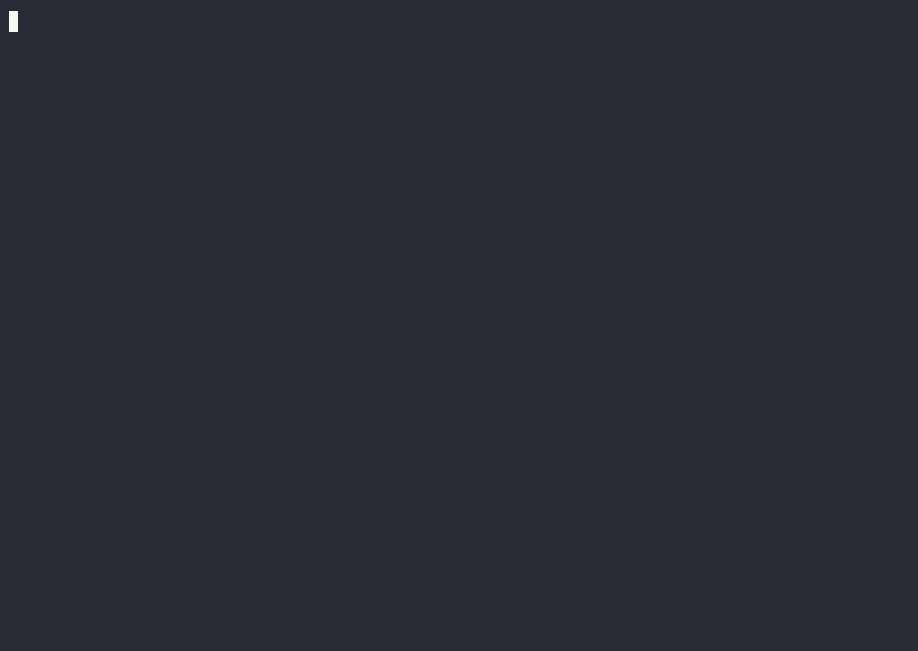

# Watch Octomind fix a bug

A deliberately buggy Python fixture with seven tests. Two tests fail because a nested range shortens a containing range.
Ask Octomind to repair the implementation, then independently rerun the tests and check the diff.



The recording shows an observed run on macOS ARM64 with Octomind **0.58.4** and
**GPT-4.1 mini through OpenRouter**, on October 16, 2026. Only `merge_ranges.py` changed; all seven tests passed in the
independent rerun. The original test file and task remained byte-for-byte unchanged.

Playback runs at 1.5× speed and shortens idle periods to one second. The [original terminal recording](demo.cast) and
[verification summary](verification.json) are included. Model responses and costs can vary between runs.

## Run it yourself

Install [Octomind](https://octomind.run/docs/usage/01-installation) and configure
[model access](https://octomind.run/docs/usage/04-providers#bring-your-own-keys). This fixture needs Python 3.9 or newer
and no Python packages. The commands below use a POSIX shell and start from the Octomind repository root.

### 1. Copy the fixture to a temporary directory

```bash
DEMO_ROOT=$(mktemp -d)
mkdir "$DEMO_ROOT/work"
cp examples/fix-a-bug/merge_ranges.py examples/fix-a-bug/test_merge_ranges.py examples/fix-a-bug/task.txt "$DEMO_ROOT/work/"
cp examples/fix-a-bug/merge_ranges.py "$DEMO_ROOT/before.py"
cp examples/fix-a-bug/test_merge_ranges.py "$DEMO_ROOT/tests.before.py"
cd "$DEMO_ROOT/work"
```

### 2. Observe the failing tests

```bash
python3 -m unittest -v
```

Expect seven tests, with two failures: `test_nested` and `test_nested_then_overlapping`.

### 3. Ask Octomind to fix the implementation

Set `OPENROUTER_API_KEY` in your environment, then run:

```bash
octomind run developer:general \
  --model openrouter:openai/gpt-4.1-mini \
  --config 'supervisor.model.name="openrouter:openai/gpt-4.1-mini"' \
  --config 'compression.model.name="openrouter:openai/gpt-4.1-mini"' \
  --config 'max_request_spending_threshold=0.25' \
  --format plain < task.txt
```

The recording used these model profiles and spending threshold in an isolated config file. The command above sets them
for this process. The threshold is in USD and is checked between model requests. The specialist's first run can fetch
its manifest and install tool dependencies; network access and model credentials are required.

The task asks the agent to change only `merge_ranges.py`, preserve the tests, and run them before and after its edit.

### 4. Verify the result independently

```bash
python3 -m unittest -v
diff -u ../before.py merge_ranges.py
cmp ../tests.before.py test_merge_ranges.py
```

The recorded run passes all seven tests. Its diff keeps the larger end when merging ranges:

```diff
-            merged[-1] = (merged[-1][0], end)
+            merged[-1] = (merged[-1][0], max(merged[-1][1], end))
```

`diff` exits with status 1 when files differ. `cmp` prints nothing and exits with status 0 when the test file is unchanged.

## Keep exploring

- [Install Octomind](https://octomind.run/docs/usage/01-installation)
- [Use it in your terminal or scripts](https://octomind.run/docs/usage/02-quickstart)
- [Star Octomind for release updates](https://github.com/muvon/octomind)
